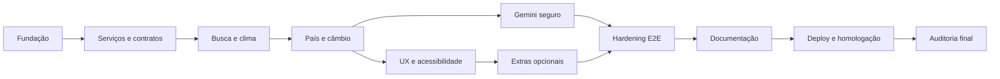

# Roadmap — TravelAI

## 1. Visão do projeto

O TravelAI será uma aplicação web cliente/servidor que pesquisa destinos, agrega e normaliza dados de diferentes Web Services e usa o Google Gemini apenas para gerar conteúdo contextual. A entrega final será acessível por uma URL pública, sem instalação pelo usuário e sem credenciais no bundle do navegador.

### Decisões iniciais

- **Frontend:** React, TypeScript estrito, Vite e Tailwind CSS.
- **Backend mínimo:** Vercel Function em `api/gemini.ts`, usada exclusivamente para manter `GEMINI_API_KEY` no servidor.
- **HTTP:** `fetch` em toda a aplicação, com timeout e erros normalizados.
- **Testes:** Vitest + Testing Library para unidade/integração e Playwright para E2E.
- **Persistência opcional:** apenas `localStorage`; não haverá login nem banco de dados.
- **Deploy:** Vercel, com validação funcional também na URL pública.

Essa combinação preserva a arquitetura solicitada com um frontend predominantemente cliente e evita a migração desnecessária para um framework full-stack. A única operação que exige segredo permanece no servidor.

## 2. Status e regras de execução

Legenda: `[x]` concluído, `[ ]` pendente, `[~]` iniciado.

Cada sprint só pode ser encerrada quando:

- código, tipos e mensagens de erro estiverem revisados;
- testes da funcionalidade estiverem implementados e passando;
- `npm run lint`, `npm run typecheck`, `npm test` e `npm run build` passarem;
- o fluxo E2E alterado tiver sido executado em desktop e mobile;
- não houver erros relevantes no console do navegador;
- documentação afetada estiver atualizada;
- nenhum segredo, token ou `.env` real estiver versionado.

## 3. Sprints

### Sprint 0 — Fundação e arquitetura-base

**Objetivo:** criar um projeto executável, estrito e testável antes das integrações.

- [x] Inicializar React + TypeScript + Vite.
- [x] Configurar Tailwind CSS e a página inicial responsiva.
- [x] Ativar TypeScript estrito e regras para código não utilizado.
- [x] Configurar ESLint, Vitest, Testing Library e Playwright.
- [x] Criar os diretórios `components`, `services`, `types`, `utils`, `hooks`, `api`, `tests` e `docs`.
- [x] Criar contratos internos iniciais para localização, clima, país, câmbio e viagem.
- [x] Criar cliente HTTP base com timeout e taxonomia inicial de erros.
- [x] Criar a função serverless placeholder para o Gemini.
- [x] Criar `.env.example` e regras para impedir commit de segredos.
- [x] Criar teste unitário do campo de busca.
- [x] Criar smoke test E2E da home, parametrizado para desktop e mobile.
- [x] Instalar dependências e gerar o lockfile.
- [x] Validar lint, tipos, teste unitário, E2E e build da fundação.

**Critério de aceite:** a home inicia, aceita uma busca por teclado e todo o pipeline local de qualidade passa.

### Sprint 1 — Contratos e camada de Web Services

**Objetivo:** transformar respostas externas em modelos internos confiáveis.

- [ ] Definir os DTOs privados das respostas de Open-Meteo, REST Countries e Frankfurter.
- [ ] Implementar validação em runtime das propriedades realmente utilizadas.
- [ ] Implementar `geocodingService` com normalização de cidade, país, ISO, coordenadas e timezone.
- [ ] Implementar `weatherService` com clima atual e exatamente cinco dias de previsão.
- [ ] Mapear códigos meteorológicos para descrição e ícone acessível.
- [ ] Implementar `countryService` por código ISO, incluindo ausência de capital, idioma ou moeda.
- [ ] Implementar `currencyService` para cotação BRL → moeda do destino.
- [ ] Definir erros de domínio: não encontrado, timeout, rede, indisponibilidade, resposta inesperada e moeda sem suporte.
- [ ] Garantir que componentes nunca recebam JSON bruto das APIs.
- [ ] Criar fixtures mínimas e sanitizadas para cada Web Service.
- [ ] Testar normalizadores, timeout, HTTP não-2xx e payload malformado.
- [ ] Adicionar testes de contrato opcionais contra os endpoints públicos, separados dos testes determinísticos.

**Critério de aceite:** cada serviço retorna somente seu modelo interno ou um erro conhecido, com testes cobrindo sucesso e falhas.

### Sprint 2 — Pesquisa e agregação do destino

**Objetivo:** executar o pipeline principal da busca e exibir destino, clima e previsão.

- [ ] Implementar estado do fluxo no `useDestination`.
- [ ] Validar e normalizar a entrada da busca.
- [ ] Executar geocodificação antes das chamadas dependentes.
- [ ] Consultar clima e país em paralelo após resolver a localização.
- [ ] Consultar câmbio somente quando existir moeda compatível.
- [ ] Definir regra de cancelamento para buscas consecutivas.
- [ ] Evitar atualização de estado por resposta obsoleta.
- [ ] Implementar `WeatherCard`, `ForecastCard` e cabeçalho do destino.
- [ ] Exibir coordenadas, país e bandeira com texto alternativo.
- [ ] Implementar estado inicial, skeleton de carregamento, resultado e erro de cidade inexistente.
- [ ] Aplicar degradação graciosa quando um serviço secundário falhar.
- [ ] Testar a orquestração e a precedência dos estados.
- [ ] E2E com APIs interceptadas: pesquisar Tokyo e validar destino, clima e cinco cards.
- [ ] E2E: buscar `asdfghxyz123` e exibir “Não encontramos esse destino”.
- [ ] E2E: iniciar Tokyo e imediatamente Paris; somente Paris pode permanecer na tela.

**Critério de aceite:** a pesquisa produz dados normalizados no dashboard e falhas secundárias não derrubam toda a página.

### Sprint 3 — País e conversor monetário

**Objetivo:** completar a composição de dados factuais do dashboard.

- [ ] Implementar `CountryCard` com capital, população, idioma, moeda e timezone.
- [ ] Formatar números, moedas e datas com `Intl`.
- [ ] Implementar `CurrencyConverter` com entrada em BRL e resultado na moeda local.
- [ ] Validar valor vazio, zero, negativo, muito grande e separadores decimais.
- [ ] Definir comportamento para países com múltiplas moedas.
- [ ] Exibir estado específico para moeda ausente ou não suportada pelo Frankfurter.
- [ ] Não consultar novamente a cotação a cada tecla quando uma multiplicação local for suficiente.
- [ ] Testar cálculos e arredondamento sem comparar strings frágeis de locale.
- [ ] E2E: converter R$ 1.000 para JPY em Tokyo usando cotação mockada.
- [ ] E2E: simular moeda não suportada e manter país/clima utilizáveis.
- [ ] E2E: validar CountryCard para cidade cujo país possui campos opcionais ausentes.

**Critério de aceite:** dados do país e conversão aparecem sem JSON bruto e sem comprometer o restante do dashboard em caso de falha.

### Sprint 4 — UX responsiva e acessibilidade

**Objetivo:** tornar o dashboard claro, profissional e utilizável em qualquer viewport prevista.

- [ ] Definir layout final para desktop, tablet e smartphone.
- [ ] Refinar skeletons sem provocar mudança brusca de layout.
- [ ] Implementar feedback de foco, hover, disabled e carregamento.
- [ ] Garantir ordem lógica de títulos e landmarks.
- [ ] Associar todos os labels, descrições de erro e campos.
- [ ] Usar regiões `status`/`alert` sem anúncios duplicados.
- [ ] Garantir contraste e alvos de toque adequados.
- [ ] Evitar dependência exclusiva de cor ou ícone para transmitir informação.
- [ ] Testar zoom e conteúdo longo, inclusive nomes extensos de cidades e moedas.
- [ ] E2E: realizar busca completa somente com teclado.
- [ ] E2E: validar ausência de overflow horizontal em Pixel 7, tablet e desktop.
- [ ] E2E: executar verificação automatizada de acessibilidade nas telas principais.
- [ ] E2E: falhar o teste caso surjam `console.error`, exceções de página ou requests inesperadamente abortados.

**Critério de aceite:** fluxos principais funcionam por teclado e passam nas verificações visual, responsiva e automatizada de acessibilidade.

### Sprint 5 — Planejador e perguntas contextuais com Gemini

**Objetivo:** adicionar inteligência generativa sem expor o segredo e sem substituir fontes factuais.

- [ ] Definir contrato discriminado para ações `plan` e `question` na função serverless.
- [ ] Validar método, content type, tamanho do body e todos os campos recebidos.
- [ ] Manter `GEMINI_API_KEY` somente em `process.env` no servidor.
- [ ] Implementar chamada server-side ao Gemini com timeout e tratamento de resposta.
- [ ] Enviar cidade, país, dias, interesses, orçamento BRL/convertido, previsão, moeda e timezone como contexto.
- [ ] Criar prompt que trate clima/câmbio/país como contexto fornecido e evite afirmações não verificadas.
- [ ] Solicitar e validar saída estruturada por dia, manhã, tarde e noite.
- [ ] Implementar formulário do planejador com duração de 1 a 14 dias e interesses selecionáveis.
- [ ] Implementar “Pergunte sobre {cidade}” reaproveitando o contexto atual.
- [ ] Separar estados de carregamento e erro da IA dos demais cards.
- [ ] Sanitizar/renderizar resposta sem injetar HTML arbitrário.
- [ ] Criar testes unitários do construtor de contexto e da validação do formulário.
- [ ] Testar a função serverless com Gemini mockado: sucesso, timeout, erro upstream e payload inválido.
- [ ] E2E: gerar roteiro de dois dias e validar estrutura diária.
- [ ] E2E: previsão de chuva no terceiro dia resulta em atividade interna na fixture controlada.
- [ ] E2E: perguntar “O que devo levar na mala?” e validar uso do destino atual.
- [ ] E2E: falha do Gemini mostra mensagem amigável sem remover o dashboard.
- [ ] Auditar bundle e artefatos para confirmar que a chave não aparece no cliente.

**Critério de aceite:** IA contextual funciona exclusivamente via servidor, degrada com segurança e nunca vira fonte primária dos dados factuais.

### Sprint 6 — Extras de baixo risco

**Objetivo:** implementar melhorias opcionais somente depois do núcleo estável.

- [ ] Criar histórico limitado de pesquisas em `localStorage`.
- [ ] Criar favoritos em `localStorage`.
- [ ] Implementar dark/light mode respeitando preferência do sistema.
- [ ] Implementar alternância °C/°F sem refazer chamadas desnecessárias.
- [ ] Implementar compartilhamento com Web Share API e fallback de copiar link.
- [ ] Criar versão de impressão/exportação do roteiro.
- [ ] Tratar storage indisponível ou corrompido sem quebrar a aplicação.
- [ ] E2E: histórico e favoritos persistem após reload.
- [ ] E2E: alternância de temperatura mantém consistência dos valores.
- [ ] E2E: impressão oculta controles e preserva o roteiro.

**Critério de aceite:** cada extra é independente, acessível e removível sem afetar o núcleo. Itens que ameaçarem prazo ou simplicidade permanecem fora da entrega.

### Sprint 7 — Suíte E2E e hardening

**Objetivo:** provar os requisitos com cenários determinísticos e uma checagem online controlada.

- [ ] Organizar Page Objects ou helpers somente onde reduzirem duplicação real.
- [ ] Centralizar fixtures e interceptações de Open-Meteo, REST Countries, Frankfurter e Gemini.
- [ ] Cobrir as cidades Tokyo, London, New York, Paris, Rio Grande e São Paulo.
- [ ] Cobrir cidade inexistente, timeout, rede offline, HTTP 5xx e resposta malformada de cada API.
- [ ] Cobrir falha parcial de país, câmbio e IA sem perda dos dados já disponíveis.
- [ ] Cobrir moeda não suportada e país sem dados opcionais.
- [ ] Cobrir conversão monetária e validações de formulário.
- [ ] Cobrir roteiro e pergunta contextual ao Gemini.
- [ ] Cobrir navegação por teclado e acessibilidade básica.
- [ ] Executar matriz Chromium desktop e Chromium mobile em toda mudança relevante.
- [ ] Adicionar um smoke E2E opcional para a URL pública via `E2E_BASE_URL`.
- [ ] Registrar trace, screenshot e vídeo apenas em falha/retry.
- [ ] Adicionar pipeline de CI: instalação limpa, lint, tipos, testes, build e E2E.
- [ ] Medir cobertura unitária e preencher lacunas de regras críticas.
- [ ] Revisar flakiness: nenhum `waitForTimeout`; esperas devem observar estado da interface ou resposta conhecida.

**Critério de aceite:** a matriz abaixo passa localmente/CI, os testes são repetíveis e nenhuma falha é ocultada por retries.

### Sprint 8 — Documentação acadêmica e apresentação

**Objetivo:** tornar arquitetura, implementação e demonstração compreensíveis e verificáveis.

- [ ] Escrever `README.md` com objetivo, stack, APIs, estrutura, execução, variáveis e deploy.
- [ ] Criar diagrama Mermaid do browser → APIs públicas e browser → function → Gemini.
- [ ] Documentar os modelos normalizados e o pipeline da pesquisa.
- [ ] Documentar a função serverless e a proteção da chave.
- [ ] Registrar decisões arquiteturais e limitações conhecidas.
- [ ] Produzir o relatório acadêmico com as 15 seções solicitadas.
- [ ] Registrar apenas dificuldades realmente observadas durante a implementação.
- [ ] Indicar pontos de inserção e produzir screenshots finais.
- [ ] Criar roteiro curto de apresentação e demo com Tokyo, uma segunda cidade e busca inválida.
- [ ] Listar os melhores arquivos para abrir durante a explicação.
- [ ] Revisar texto, referências, diagramas e consistência com o software entregue.

**Critério de aceite:** uma pessoa que não participou do desenvolvimento consegue executar, entender e apresentar o sistema usando a documentação.

### Sprint 9 — Deploy e homologação pública

**Objetivo:** entregar uma versão online segura e validar a experiência real.

- [ ] Criar ou vincular projeto na Vercel somente com autorização do responsável.
- [ ] Configurar `GEMINI_API_KEY` como variável protegida na Vercel.
- [ ] Confirmar framework, build, output e roteamento SPA/API.
- [ ] Fazer deploy de preview e executar smoke tests.
- [ ] Promover para produção após aprovação dos checks.
- [ ] Testar abertura direta, refresh e rotas na URL pública.
- [ ] Testar APIs públicas e verificar ausência de erros CORS.
- [ ] Testar Gemini real sem registrar prompt sensível ou chave.
- [ ] Executar E2E remoto em desktop e mobile.
- [ ] Inspecionar console, network e artefatos publicados.
- [ ] Confirmar que nenhum segredo está presente no bundle/source map.
- [ ] Registrar URL, data, commit e resultado da homologação.

**Critério de aceite:** a aplicação funciona pela URL pública nos fluxos obrigatórios e a credencial Gemini só existe no ambiente server-side.

### Sprint 10 — Auditoria final e entrega

**Objetivo:** avaliar o projeto com os mesmos critérios esperados do professor.

- [ ] Executar instalação limpa e todos os comandos de qualidade.
- [ ] Revisar dependências, licenças e vulnerabilidades relevantes.
- [ ] Procurar código duplicado, morto, comentários óbvios e componentes grandes.
- [ ] Revisar tratamento de exceções e mensagens apresentadas ao usuário.
- [ ] Revisar semântica, acessibilidade e responsividade manualmente.
- [ ] Repetir a demonstração completa cronometrada.
- [ ] Conferir requisitos contra a matriz de rastreabilidade.
- [ ] Documentar problemas conhecidos e passos restantes, se houver.
- [ ] Gerar checklist final com funcionalidades, APIs, testes, arquivos principais e URL.

**Critério de aceite:** não existem pendências obrigatórias abertas, e limitações residuais estão explicitamente documentadas.

## 4. Matriz E2E mínima

| ID | Cenário | Ambiente | Evidência esperada |
|---|---|---|---|
| E2E-01 | Abrir home | Desktop + mobile | Título, chamada e busca visíveis; console limpo |
| E2E-02 | Buscar Tokyo por teclado | Desktop + mobile | Destino, Japão, clima, cinco dias e JPY |
| E2E-03 | Buscar London | Desktop | Reino Unido, clima e GBP normalizados |
| E2E-04 | Buscar New York | Desktop | Estados Unidos e USD, sem ambiguidade indevida |
| E2E-05 | Buscar Paris | Mobile | França, EUR e layout sem overflow |
| E2E-06 | Buscar Rio Grande | Desktop | Resultado brasileiro correto e BRL tratado |
| E2E-07 | Buscar São Paulo com acento | Mobile | Entrada Unicode e destino corretos |
| E2E-08 | Buscar `asdfghxyz123` | Desktop + mobile | Mensagem amigável e possibilidade de tentar novamente |
| E2E-09 | Timeout da meteorologia | Desktop | País disponível e erro parcial de clima |
| E2E-10 | REST Countries indisponível | Desktop | Destino/clima preservados; país marcado indisponível |
| E2E-11 | Moeda não suportada | Desktop | Conversor indisponível sem quebrar os demais cards |
| E2E-12 | Converter R$ 1.000 | Desktop + mobile | Resultado exato com fixture de cotação |
| E2E-13 | Gerar roteiro de 1 e 14 dias | Desktop | Limites aceitos e estrutura por dia |
| E2E-14 | Rejeitar 0 e 15 dias | Desktop | Validação acessível; Gemini não chamado |
| E2E-15 | Chuva no contexto do roteiro | Desktop | Fixture gera atividade interna no dia chuvoso |
| E2E-16 | Pergunta contextual | Desktop | Resposta considera cidade e clima carregados |
| E2E-17 | Gemini indisponível | Desktop + mobile | Erro isolado e dashboard preservado |
| E2E-18 | Nova busca durante request ativo | Desktop | Resposta antiga não sobrescreve a nova |
| E2E-19 | Fluxo completo por teclado | Desktop | Foco visível e todos os controles operáveis |
| E2E-20 | URL pública | Desktop + mobile | Busca, câmbio, Gemini, refresh, CORS e console válidos |

Os testes E2E locais e de CI usarão interceptação de rede para serem determinísticos. A homologação usará poucos smoke tests contra serviços reais e a URL publicada, evitando transformar instabilidade externa em falso negativo da suíte principal.

## 5. Rastreabilidade dos requisitos

| Requisito | Sprints responsáveis |
|---|---|
| Cliente/servidor e composição de Web Services | 1, 2, 3, 5 |
| Open-Meteo | 1, 2, 7 |
| REST Countries | 1, 3, 7 |
| Frankfurter | 1, 3, 7 |
| Gemini contextual e chave protegida | 5, 9 |
| Dashboard e modelos normalizados | 1, 2, 3 |
| Tratamento de erros e degradação graciosa | 1, 2, 3, 5, 7 |
| Responsividade e acessibilidade | 4, 7, 9 |
| Extras opcionais | 6 |
| Testes e cidades obrigatórias | 2, 3, 4, 5, 7 |
| README, relatório e apresentação | 8 |
| Deploy totalmente online | 9 |
| Revisão final de qualidade e segurança | 10 |

## 6. Ordem de entrega e dependências



## 7. Comandos de verificação planejados

```bash
npm run lint
npm run typecheck
npm test
npm run test:coverage
npm run build
npx playwright install chromium
npm run test:e2e
```

Para validar um deploy existente sem iniciar o servidor local:

```bash
E2E_BASE_URL=https://url-publica.example npm run test:e2e
```

No PowerShell, a variável deve ser definida com `$env:E2E_BASE_URL` antes do comando.
